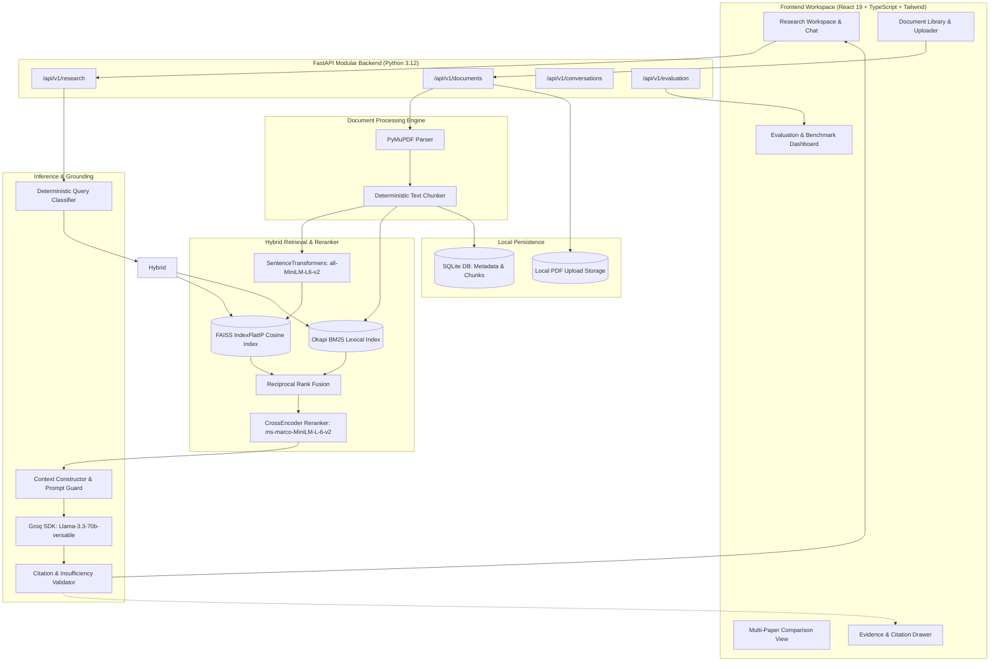

# ResearchPilot System Architecture & Data Flow

## Security & Reliability Design
1. **Zero Secret Leakage:** Groq API keys remain strictly on the backend. Frontend queries only talk to the internal API.
2. **Untrusted Document Content Guard:** Document text injected into prompts is wrapped in explicit context delimiters and treated as untrusted text to prevent prompt injection.
3. **Deterministic ID Stability:** SHA-256 chunk hashing ensures chunk identifiers and citations remain stable across application restarts.
4. **Local Hardware Efficiency:** Quantized, lightweight embedding and cross-encoder models (~80MB RAM) execute locally without requiring a dedicated GPU or paid cloud vector services.
